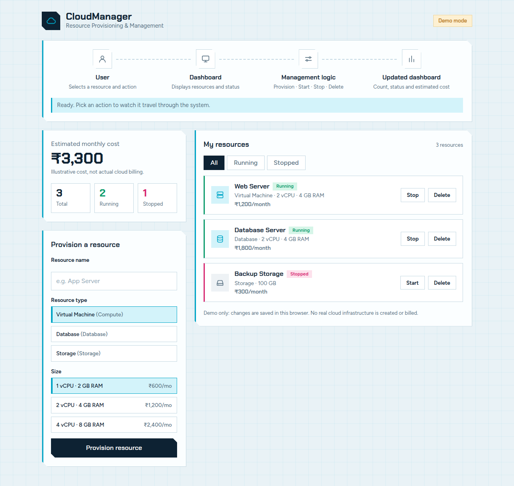
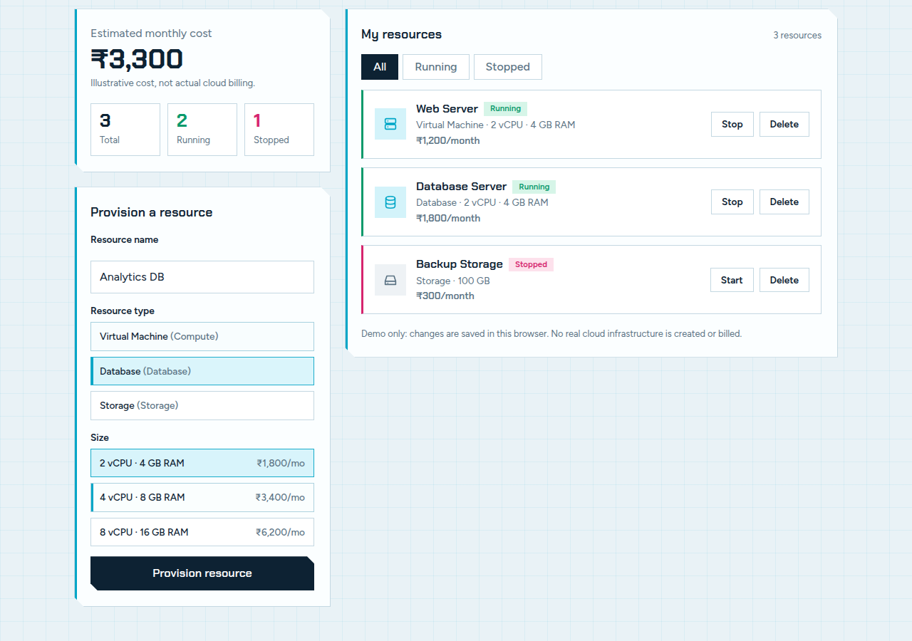
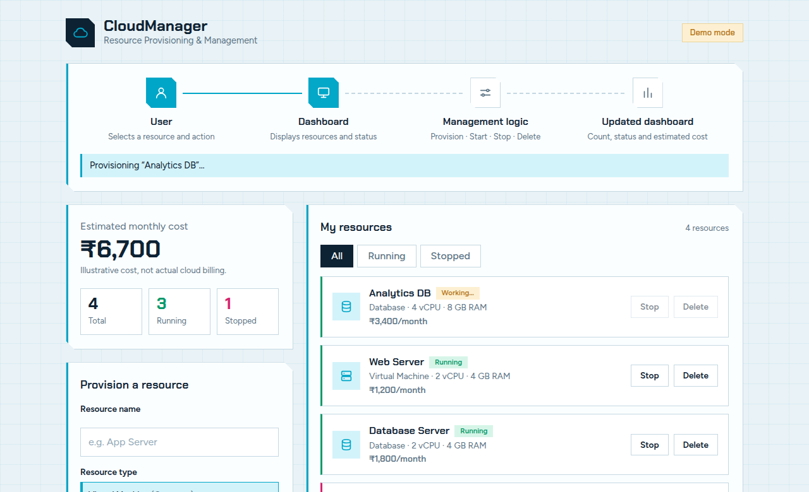
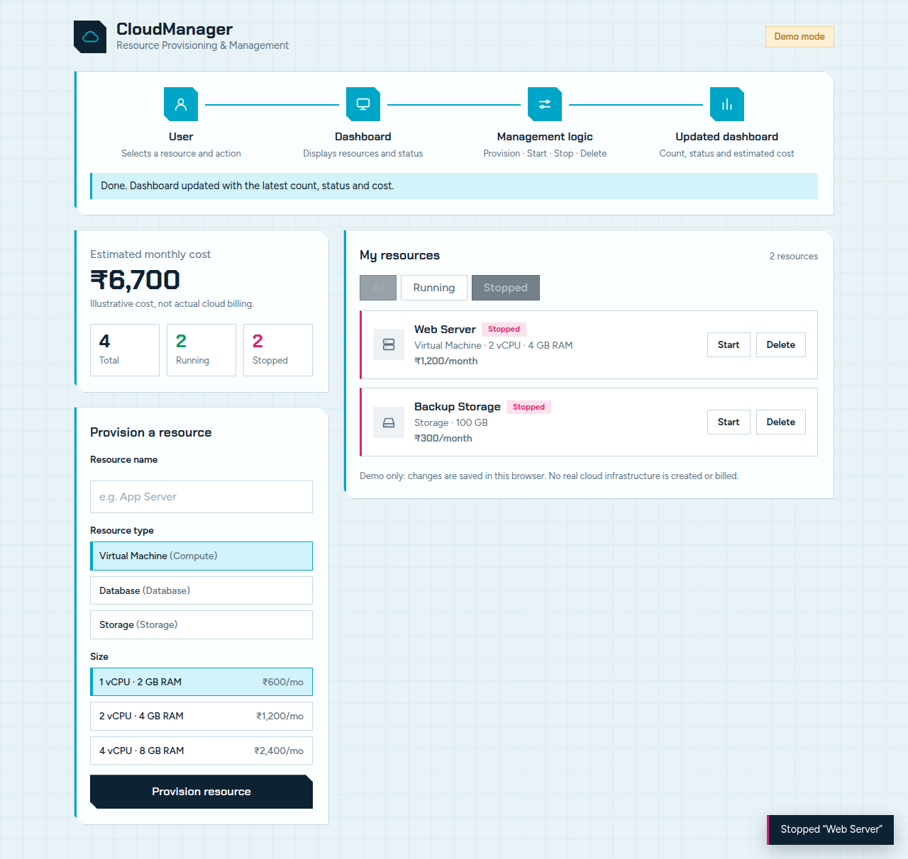
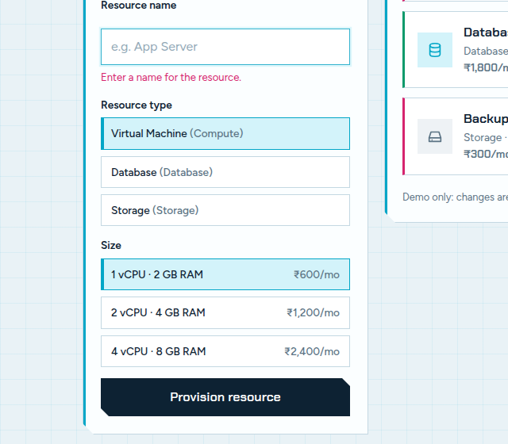
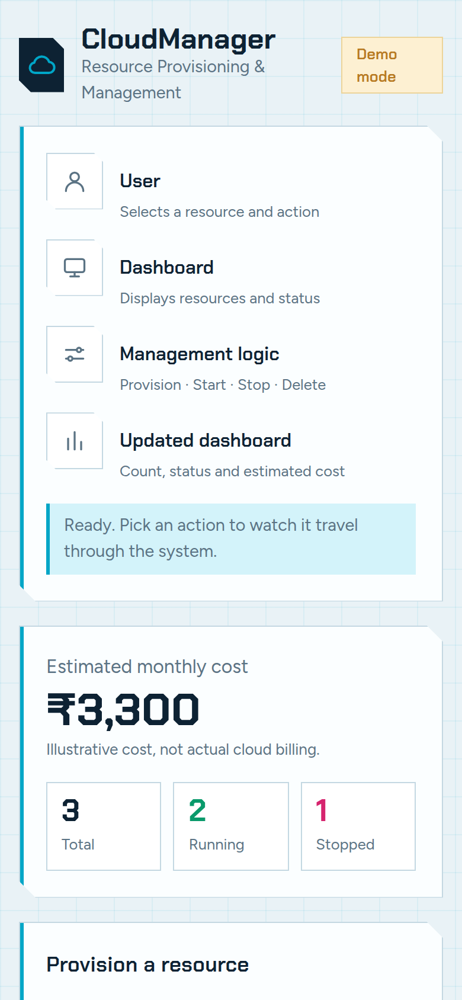

# CloudManager – Cloud Resource Provisioning & Management

A simple, front-end-only demo app for provisioning and managing simulated cloud resources. Built with plain HTML, CSS and JavaScript, with a light, cyber-themed UI. No real cloud infrastructure is created or billed.

## Screenshots

**Dashboard** – flow pipeline, estimated monthly cost, resource counts, provisioning form and resource list.



**Provisioning a resource** – choose a name, type and size. Each size shows its monthly price.



**Flow animation** – every action travels through User → Dashboard → Management logic → Updated dashboard. The new resource shows a "Working…" state until the flow completes.



**Filtering** – the Stopped tab after stopping the Web Server.



**Validation** – an empty name shows an error instead of provisioning.



**Mobile** – the layout stacks into a single column on small screens.



## Features

- Provision Virtual Machines, Databases and Storage, each with three sizes and ₹ prices
- Start, stop and delete resources
- Live resource counts (total, running, stopped) and estimated monthly cost
- All / Running / Stopped filter tabs
- Animated flow pipeline that mirrors the app's logic
- Toast confirmations for every action
- Resources persist in the browser via `localStorage`
- Responsive layout, visible keyboard focus, and reduced-motion support

## Run it

No build step or server is needed. Open `index.html` in a browser.

The page loads the Chakra Petch and Figtree fonts from Google Fonts, and falls back to system fonts when offline.

To reset the demo data, clear this site's `localStorage` (key `cloudmanager.resources.v1`).

## Project structure

```
index.html   page structure
style.css    light cyber theme, layout, responsive rules
app.js       resource state, rendering, flow animation, form handling
screenshots/ images used in this README
```

## Cost model

The estimate is the sum of the monthly price of every resource, including stopped ones, matching the reference design. Prices are illustrative.
